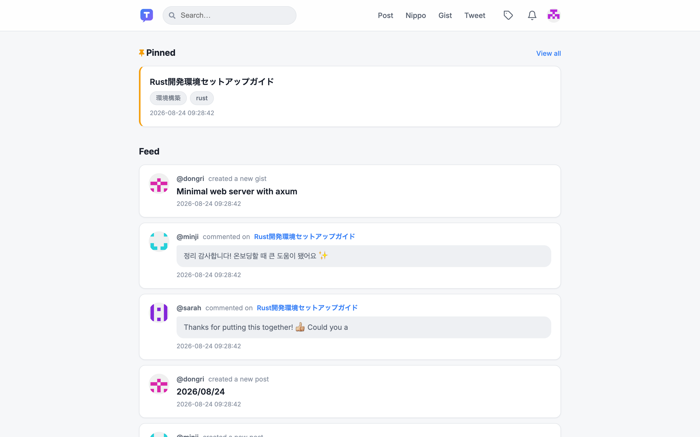
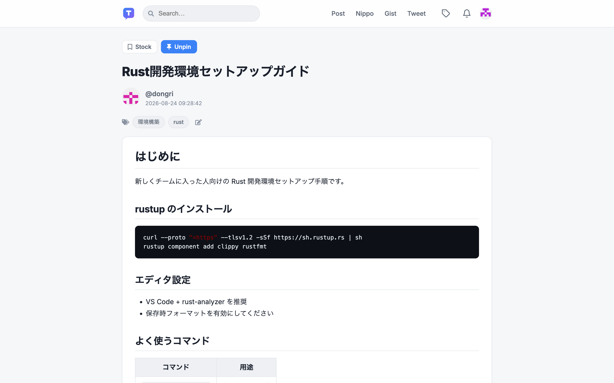
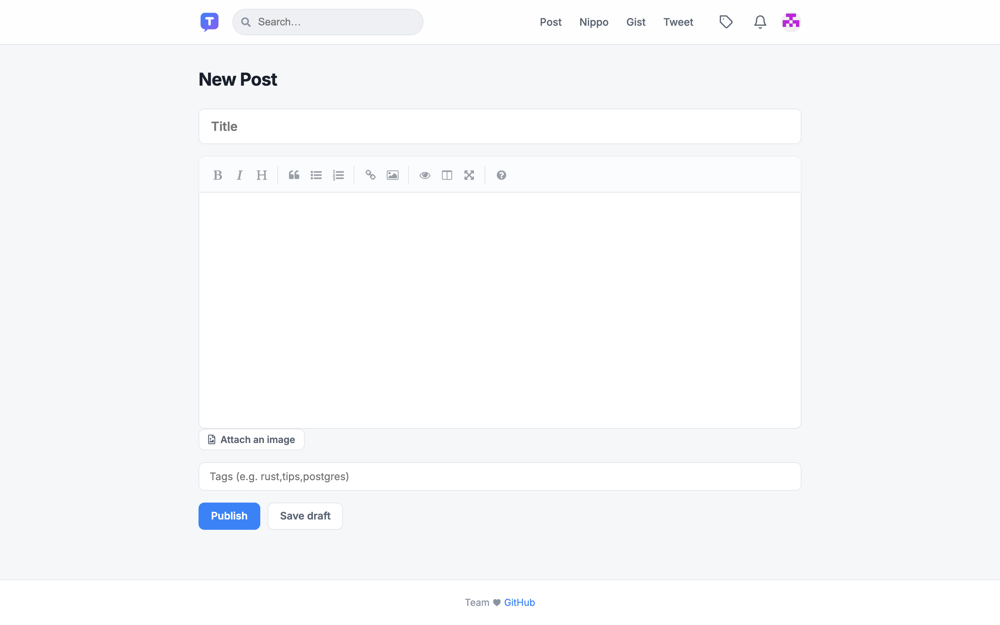
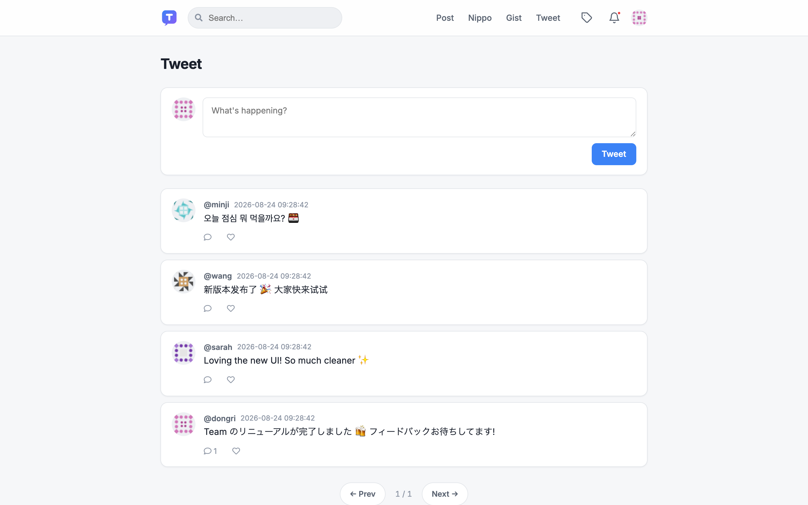

# Team

A knowledge-sharing tool for teams. Bring articles, daily reports, code snippets, and short updates together in one place, with everything broadcast to Slack.

## Demo

Try the live demo: https://team.huatuo.xyz

- **Post** — knowledge articles written in Markdown (tags, comments, stock, pin, co-editing)
- **Nippo** — daily reports with a template-equipped editor
- **Gist** — code snippets with syntax highlighting
- **Tweet** — short updates and replies
- **Slack notifications** — every activity is delivered as a unified Block Kit message
- **Auth** — username/password or Google sign-in (with optional domain restriction)
- Light / dark theme

## Screenshots

| Feed | Post |
|---|---|
|  |  |

| Editor | Tweet |
|---|---|
|  |  |

## Tech Stack

- **Backend**: Rust / [Axum](https://github.com/tokio-rs/axum) + Tokio
- **Database**: PostgreSQL (tokio-postgres + deadpool)
- **Templates**: Handlebars (server-side rendering)
- **Frontend**: Vanilla JS + custom CSS

## Setup

### 1. Environment variables

```sh
cp .env.example .env
```

`.env` is loaded automatically by both the app itself (dotenvy) and docker compose.
See [.env.example](.env.example) for a description of each variable.

`TEAM_SECRET_COOKIE` is required (32+ characters) and the app refuses to
start without it:

```sh
openssl rand -hex 32
```

### 2-a. Run with Docker

```sh
docker compose up
```

The app starts at http://localhost:3000 (PostgreSQL included; the source
directory is mounted, so changes rebuild automatically).

### 2-b. Run locally

```sh
createdb team
psql team < ddl.sql

cargo run
# or with hot reload during development
cargo install cargo-watch
cargo watch -x run
```

## Test

```sh
cargo test
```

## Deploy

### Docker Compose

[compose.prod.yml](compose.prod.yml) builds a release image
([Dockerfile](Dockerfile)) and runs it. Point `TEAM_DATABASE_URL` in `.env`
to your database, then:

```sh
docker compose -f compose.prod.yml up --build -d
```

### Deploying directly on a server

1. Build (or transfer a binary built by CI):

   ```sh
   cargo build --release
   ```

2. Place `target/release/team` on the server along with the `templates/` and
   `public/` directories (templates and static assets are read from the
   working directory at runtime).

3. Run it as a systemd service:

   ```ini
   # /etc/systemd/system/team.service
   [Unit]
   Description=Team
   After=network.target postgresql.service

   [Service]
   WorkingDirectory=/opt/team
   ExecStart=/opt/team/team
   EnvironmentFile=/opt/team/.env
   Restart=always

   [Install]
   WantedBy=multi-user.target
   ```

   ```sh
   sudo systemctl enable --now team
   ```

4. In production, terminate TLS with a reverse proxy such as Nginx and set
   `TEAM_DOMAIN` to the public URL (e.g. `https://team.example.com`).
   Set `TEAM_TRUST_PROXY=true` so the client address is taken from
   `X-Forwarded-For`, and make sure the proxy forwards the original `Host`
   header (`proxy_set_header Host $host;`).

## Security checklist

Before exposing an instance to the internet:

- **Close sign-up.** With the defaults anyone who can reach the server can
  create an account and read everything. Set `TEAM_SIGNUP_CODE` (invitation
  code) or `TEAM_SIGNUP_ENABLED=false` once your team has accounts.
- **Restrict Google sign-in** with `TEAM_GOOGLE_ALLOW_DOMAIN`; without it any
  Google account can sign in.
- **Use HTTPS** and an `https://` `TEAM_DOMAIN`, which turns on the `Secure`
  flag for session cookies.
- Uploaded images under `public/img/posts` and `public/img/profile/icons`
  are served without authentication (file names are random, but the URLs
  are shareable). Keep that in mind for sensitive screenshots.

Built-in protections: Argon2id password hashes, signed `HttpOnly`
`SameSite=Lax` session cookies, same-origin enforcement on every
state-changing request, sign-in throttling, OAuth `state` validation,
parameterized SQL, HTML escaping in templates and Markdown rendered with
raw HTML disabled.

## License

MIT License

Copyright (c) 2019 Dongri Jin

Permission is hereby granted, free of charge, to any person obtaining a copy
of this software and associated documentation files (the "Software"), to deal
in the Software without restriction, including without limitation the rights
to use, copy, modify, merge, publish, distribute, sublicense, and/or sell
copies of the Software, and to permit persons to whom the Software is
furnished to do so, subject to the following conditions:

The above copyright notice and this permission notice shall be included in all
copies or substantial portions of the Software.

THE SOFTWARE IS PROVIDED "AS IS", WITHOUT WARRANTY OF ANY KIND, EXPRESS OR
IMPLIED, INCLUDING BUT NOT LIMITED TO THE WARRANTIES OF MERCHANTABILITY,
FITNESS FOR A PARTICULAR PURPOSE AND NONINFRINGEMENT. IN NO EVENT SHALL THE
AUTHORS OR COPYRIGHT HOLDERS BE LIABLE FOR ANY CLAIM, DAMAGES OR OTHER
LIABILITY, WHETHER IN AN ACTION OF CONTRACT, TORT OR OTHERWISE, ARISING FROM,
OUT OF OR IN CONNECTION WITH THE SOFTWARE OR THE USE OR OTHER DEALINGS IN THE
SOFTWARE.
